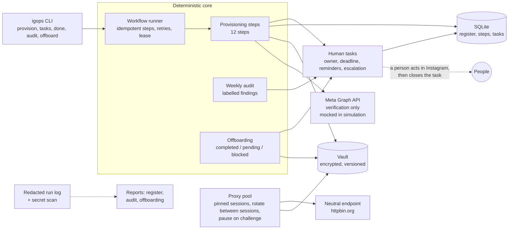

# igops: semi-automated operations for one Instagram brand account

[](https://github.com/coder-irwin/instagram-account-ops/actions/workflows/tests.yml)


A prototype that provisions, secures, audits and offboards **one company-authorised Instagram brand account**. Code does the coordination and record-keeping. People do signup, verification and anything Instagram offers no supported integration for. Every handoff is a tracked task with an owner, a deadline, reminders and escalation, and the workflow resumes cleanly afterwards.

## Quick start (2 minutes)

You need Python 3.11 or newer. The project uses [uv](https://docs.astral.sh/uv/). If you don't have it, run `pip install uv`.

```bash
uv sync --extra dev
uv run pytest -q                                # 28 tests
uv run python -m igops demo                     # the full walkthrough, about 10 seconds
uv run python -m igops --state state/demo status  # look at what the demo produced
```

The demo keeps its results in `state/demo/`, so add `--state state/demo` to inspect them. The reports land in `state/demo/reports/`, and a saved copy is in [deliverables/](deliverables/).

To show reminders, escalation and a "three months later" audit without waiting, **the demo fast-forwards its clock**. That's why some report timestamps are days or months ahead of today.

Quality gates, which also run on GitHub for Python 3.11, 3.12 and 3.13:

```bash
uv run --with ruff ruff check . && uv run --with ruff ruff format --check .   # lint and format
uv run --with mypy mypy igops                                                 # type check
```

## Architecture



Everything a platform does not support through an API is a human task. Code never touches Instagram's sign-up, login or settings.

**Read [DECISION_LOG.md](DECISION_LOG.md) first.** How it was tested, and the defects that review found and fixed, are in [docs/ENGINEERING_REVIEW.md](docs/ENGINEERING_REVIEW.md). The step-by-step guide for the real account is [LIVE_RUNBOOK.md](LIVE_RUNBOOK.md).

## Environment and assumptions

GAJAN asked for the whole environment to be simulated, in an email from Gagandeep Thind on 19 October 2026: no real Instagram account, no real company systems and no live proxies. Here is what stands in for each part:

| Brief asks for | What this submission uses |
|---|---|
| Throwaway test brand and brand kit | **Monsoon Threads**, an invented apparel brand. See [brand_kit/README.md](brand_kit/README.md). |
| Test company email and phone | `monsoonthreads.example`, a reserved domain that can't be real, and `+1 555 0142 001`, a reserved fictional number |
| Vault | A local encrypted file vault. The demo stores and reads the password, backup codes and proxy credentials, showing only versions and fingerprints. HashiCorp Vault and 1Password adapters exist for a real deployment. |
| Human task owners | **Owner A** owns the tasks, **Ops Lead** gets escalations, and **Editor C** is a normal team member |
| Departing team member | **Owner B (leaving)**, holding a designated temporary role, `insights_viewer`. The offboarding run targets them. |
| Meta business and Instagram | A clearly labelled mock of the official Graph API. Steps with no supported API are human tasks. |
| Approved proxies | Two local authenticated test proxies started by the demo. No live proxies. |
| Neutral endpoint | **http://httpbin.org/headers**, which echoes which proxy carried each request. **/status/403** stands in for a security challenge. If httpbin is unreachable, the demo uses a local endpoint and says so. |

**Other assumptions:**

- The account owner does every Instagram action by hand: signup, verification, two-factor, the business switch, profile edits and Business Suite roles.
- Simulated human completions in the demo are labelled "(simulated)".
- Every "integration-verified" result that came from the mock is labelled "(simulated)".

## If a real environment is provided later

Every stand-in can be replaced with real access in about ten minutes:

```bash
uv run python -m igops setup      # real values; secrets typed hidden, straight into the vault
uv run python -m igops doctor     # lists anything still missing, each with its fix
uv run python -m igops provision  # the live run: stops at each human step, resumes after
```

`setup` supports a local encrypted vault, HashiCorp Vault and 1Password. A test rehearses this path end to end against fake versions of GAJAN's services, using the real Meta client and real proxy checks.

## Deliverables: where each one is

| The brief asks for | File |
|---|---|
| Redacted run log | [deliverables/run_log_redacted.jsonl](deliverables/run_log_redacted.jsonl). Every line was redacted before it was written. |
| Account register | [deliverables/account_register.md](deliverables/account_register.md), with a [JSON](deliverables/account_register.json) copy |
| Audit report, one demonstrated run | [deliverables/audit_report_three_months_later.md](deliverables/audit_report_three_months_later.md) is the weekly run that flags a non-company recovery email and stale access. The other `audit_report_*` files are the same audit at earlier points. |
| Offboarding report | [deliverables/offboarding_report.md](deliverables/offboarding_report.md) for Owner B (leaving): 4 completed. [The first pass](deliverables/offboarding_report_first_pass.md) shows all 4 pending. |
| Human task list | [deliverables/tasks.md](deliverables/tasks.md), with owner, deadline, reminders and escalation for every task |
| One-page decision log | [DECISION_LOG.md](DECISION_LOG.md) |
| Screen recording | Linked in the submission email |

## The human steps

The code never does these. It creates each one as a task with an owner, a deadline, reminders and escalation, waits, then resumes:

| Step | Owner does | Closes the task with |
|---|---|---|
| Handle | Checks candidates one at a time on instagram.com, and picks the first available | `done ID handle=<chosen>` |
| Email alias | Creates `instagram@<company domain>`, routed to the owner | `done ID alias=<address>` |
| Phone | Reserves a company-controlled number. A non-company number is refused. | `done ID phone=<number>` |
| Signup | Searches for the handle first, so never a second account. Signs up in the official app and completes verification. | `done ID handle=<h> created=new` |
| Two-factor | Turns on an authenticator app. Stores the backup codes with `vault put ... --prompt`. | `done ID method=authenticator_app` |
| Business link | Switches to a business account and adds it to the Meta business | `done ID ig_user_id=<id>` |
| Profile | Sets the name, bio (150 characters max), link, category and image from the brand kit | `done ID done=yes` |
| Roles | Grants each person only their listed permission | `done ID granted=yes` |
| Offboarding | Removes the leaver's role, changes the password, replaces the backup codes | `done ID ...=yes` |
| Security challenge | Resolves it by hand in the official app. Automation stays paused until then. | `done ID resolved=yes` |

Task evidence can never contain a secret. `done` refuses fields named like password, code, secret or token.

## Proxy and session policy: when to rotate, when to preserve

- **Preserve the connection for the whole life of an active session.** Each session is pinned to one proxy and reuses one keep-alive connection. Changing IP inside a logged-in session looks like account takeover to a platform, and triggers security checks.
- **Retry on the same proxy.** Timeouts and connection errors get a bounded number of retries with backoff, all on the proxy the session already uses.
- **Rotate only between sessions:**
    - On schedule, when a session reaches its age or request budget.
    - On failover, when a proxy fails health checks or is unreachable after its retries. The broken session ends and a new one starts on a healthy proxy.
- **Never rotate to get around enforcement.** A security challenge, block or rate limit (HTTP 401, 403 or 429, or challenge wording) pauses the account. It opens a human task, and every further request is refused, including failover, until a person clears it.
- **Redact everything.** Proxy URLs and credentials live only in the vault. Logs name proxies, such as `proxy-a`, never their address or password.
- **Instagram itself is never reached through a proxy.** Meta's official API needs none. Proxies are demonstrated only against the neutral endpoint.

## Scheduling the weekly audit

`uv run python -m igops schedule` prints the cron line, which runs every Monday at 09:00. Add it with `crontab -e`. Run `sweep` every 15 minutes the same way, for reminders and escalation. The demo runs the audit directly, so you can see the results without waiting a week.

## What is real and what is simulated

| Part | Status |
|---|---|
| Workflow engine, task tracking, reminders, escalation, crash recovery | Real, runs as is |
| Vault: encrypted, versioned, values never printed | Real local vault, plus HashiCorp Vault and 1Password adapters tested against fakes |
| Account register, audit, offboarding, reports, secret scan | Real |
| Proxy health checks, timeouts, retries, pinned sessions, rotation, failover, challenge pause | Real, run against a local neutral endpoint and two local test proxies |
| Meta Graph API verification of the Instagram profile | Real client written. **Simulated in the demo**, because no Meta token for GAJAN's test business has been provided yet. Everything simulated is labelled "simulated" in every report. |
| Instagram signup, two-factor, profile edits, business conversion, Business Suite roles | **Human steps by design.** Instagram has no supported API for them. |

## What the demo shows

1. **Provisioning pauses at each human handoff.** It covers handle availability, the email alias, the phone number, signup, two-factor, business linking, the profile and role grants. A simulated owner completes each task and the workflow continues.
2. **A reminder, then one escalation,** when the signup task goes overdue. Sweeping again never escalates twice.
3. **A crash mid-run.** The rerun resumes at the interrupted step. There is still exactly one signup task, so no duplicate account is possible. The generated password is not regenerated.
4. **A transient Meta API error** is retried with backoff, then verification succeeds.
5. **Audits:**
   - Mid-provisioning, it flags missing backup codes, two-factor off and incomplete setup.
   - After setup, it finds nothing, and earlier follow-ups close themselves.
   - Three months later, it flags a personal recovery email and stale access.
6. **Offboarding Owner B (leaving).** The first pass leaves 4 actions pending. Once people act, all 4 are completed: role removed, password rotated, backup codes replaced, and vault access revoked.
7. **Proxies:**
   - Health checks pass.
   - A session stays on one proxy.
   - Rotation happens only between sessions.
   - When a proxy is killed, the session ends and fails over to a new one.
   - A security challenge pauses the account, opens a human task, and refuses to reconnect, even through failover.
8. **A secret scan.** Every vault value is decrypted and searched for in every output file. The result is 0 leaks.

## Commands for the real account

```bash
uv run python -m igops status                         # register, steps, open tasks
uv run python -m igops provision                      # run or resume; safe to run repeatedly
uv run python -m igops tasks                          # what people need to do
uv run python -m igops done 7 ig_user_id=1784...      # close a task with non-secret evidence
uv run python -m igops sweep                          # reminders and escalation (cron every 15 min)
uv run python -m igops vault put vault://... --prompt # store a secret with hidden input
uv run python -m igops vault list                     # references and metadata, never values
uv run python -m igops vault verify                   # decrypt each secret, show only a fingerprint
uv run python -m igops audit                          # run the audit now
uv run python -m igops schedule                       # prints the weekly cron line
uv run python -m igops offboard person@company        # offboard someone, rerun to continue
uv run python -m igops proxy-check                    # health-check the configured proxies
uv run python -m igops report                         # register, tasks, run log, secret scan
```

Set `mode = "live"` in `config/brand.toml` to use the real Meta API client instead of the simulation.

## Configuration

`config/brand.toml` holds the brand, people and their least-privilege roles, company contacts, proxies and policy. It contains **no secrets**, only `vault://` references. Values marked `CHANGE` come from GAJAN's test environment. The loader refuses:
- a bio over 150 characters
- a non-company email for a team member
- unknown roles
- more than two admins
- a proxy written as a literal URL instead of a vault reference

## How secrets are handled

- **The vault key is kept outside the project,** in `~/.config/igops/keys` with permissions 600, so copying or zipping the project never copies the key.
- **Secrets live only in the vault.** That covers the password, backup codes, proxy URLs, the Meta token and SMTP credentials. The database, config and reports hold only `vault://` references.
- **Secrets are entered with `vault put --prompt`.** Input is hidden, and the command refuses values passed as arguments, which would land in shell history.
- **Task evidence can't carry secrets.** Completing a task with a field named like `password`, `code`, `secret` or `token` is rejected.
- **Every log line is redacted before it is written.** Any value read from the vault is registered with the redactor, and URL credentials, tokens and authorization headers are masked by pattern.
- **The report step finishes with a secret scan** that checks all outputs against the decrypted vault contents.

## Reliability

- **Steps are idempotent and recorded in SQLite.** Finished steps never rerun, and a crash leaves the step resumable.
- **Tasks are keyed by the real-world need,** such as `signup:<brand>`. Asking twice returns the same task, so a resume cannot request a second account.
- **A lease stops two runners** from provisioning the same account at once. A lease held by a killed process is taken over immediately.
- **Transient errors get bounded retries** with exponential backoff and jitter. Hard errors stop the step and are recorded as failed or blocked, never silently skipped.
- **Missing access is a blocker, not a crash.** It is written to the register with the exact command that resumes once it is cleared.

## Limitations

- **The Meta API path is unverified against a real account,** because GAJAN's test business access hasn't been provided. The client follows the documented Graph API fields. Role assignment through the Business Management API is left as a human task until permissions are confirmed.
- **Email-alias and phone reservation are human requests.** No mail or telephony integration was specified.
- **Notifications go to the run log,** and to email once SMTP credentials are in the vault. There is no Slack integration.
- **Part D, the device fleet, was not built.** It is optional, and the brief rewards one complete path over breadth.
- **The HashiCorp and 1Password adapters are tested against fakes only.** Check them once against the real vault.

## Layout

```
igops/core.py        clock, redaction, redacted run log
igops/vault.py       local encrypted vault, HashiCorp and 1Password adapters
igops/golive.py      `setup` wizard and `doctor` readiness check
igops/store.py       SQLite: register, people, roles, tasks, steps, findings, lease
igops/tasks.py       human tasks: idempotent creation, reminders, escalation, notifier
igops/workflow.py    resumable step runner with bounded retries
igops/provision.py   the provisioning workflow (12 steps)
igops/audit.py       weekly audit with verification labels and follow-ups
igops/offboard.py    offboarding across accounts: completed, pending, blocked
igops/proxy.py       proxy pool: health, pinning, rotation, failover, challenge pause
igops/neutral.py     local neutral endpoint and test proxies
igops/providers/meta.py   official Graph API client and the labelled simulation
igops/reports.py     register, audit, offboarding, tasks, run log, secret scan
igops/demo.py        the scripted end-to-end walkthrough
brand_kit/           the invented sample brand (Monsoon Threads)
deliverables/        reports from the last demo run
docs/                engineering review, recording script
.github/workflows/   CI: lint, types, tests and demo on Python 3.11 to 3.13
```
